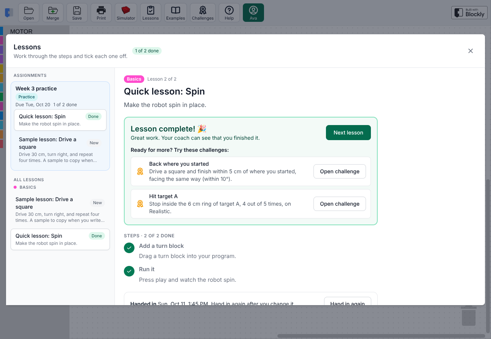
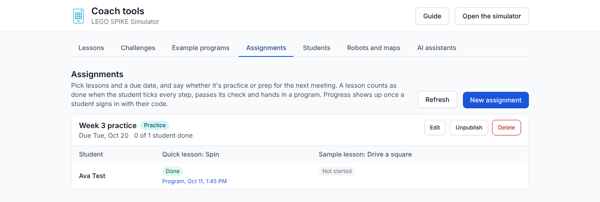

# LEGO SPIKE Simulator

> **This is a modified version** of the
> [LEGO SPIKE Simulator by Alexandre Hardy](https://github.com/alexandrehardy/lego-spike-simulator).
> Changes made in this fork since October 2026 add a self-hosting server, a
> shared library, lessons and challenges that check themselves, student sign-in
> with saved progress, assignments, a coach page and AI assistant tools. They
> are listed in [docs/what-this-fork-adds.md](docs/what-this-fork-adds.md), and
> every change is in the git history. Like the original, it is distributed under
> the GNU General Public License version 2 (see [COPYING.md](COPYING.md)).

Write SPIKE word-block programs in the browser and watch a 3D LEGO robot run
them on a competition-style mat, before trying them on the real robot. This
fork turns the simulator into a site for a robotics team: students work through
lessons and challenges and their progress is saved, and coaches set assignments
and manage everything from one page.

It works on laptops, Chromebooks and full-size tablets. Phones and small
tablets are not supported, because their screens are too small for block
coding.



## What's in it

**For students**

-   Lessons with a Set up button, steps to tick off and a check, and challenges
    with hints, both checked automatically over five runs.
-   Eight example programs with explanations, block help on hover and
    right-click, and a guide with a searchable block reference.
-   Realism levels that add wheel slip, gyro drift and sensor noise, so programs
    that use sensors beat programs that only count rotations.
-   A sensor graph, a measuring tool, a top-down Place view, and an experiment
    panel that compares two programs over five runs each.
-   Sign in with a code (no email), saved progress on any computer,
    assignments with due dates, and Hand in.

**For coaches** (the coach page at `/coach`)

-   Write lessons and challenges with a live preview, and draw their checks on
    the mat.
-   Set assignments and see every student's progress and handed-in programs.
-   Manage the roster, print sign-in cards, manage robots, fields and example
    programs, and change team settings.
-   Connect an AI assistant to write lessons, set assignments and draw practice
    mats, with everything saved as a draft until a coach publishes it.

The full list is in [docs/what-this-fork-adds.md](docs/what-this-fork-adds.md).



## Run your own copy

The server and the LDraw parts library come in one Docker image:

```
docker run -d -p 8093:8080 -v /path/to/data:/data \
    -e LAN_WRITE_PREFIXES=192.168.0. \
    ghcr.io/danmartinez78/lego-spike-simulator:latest
```

Then open `http://<host>:8093`. On the first start the container downloads the
LDraw parts library and copies the bundled robots, fields, examples, lessons and
challenges into the library.

`/data/library` holds the shared library, `/data/team` the roster, settings,
progress and handed-in programs, and `/data/ldraw` the parts library. Delete
`/data/ldraw` to fetch a newer parts library on the next start. The coach page's
Students tab can download a backup of `team` and `library`; to restore it, unzip
it into `/data`.

### Who can make changes

Everyone can use the simulator, lessons and challenges. Students sign in with
their codes. Coach changes (the coach page, saving to the library, the AI
assistant connection) are allowed for:

-   devices on your home network that connect directly, when
    `LAN_WRITE_PREFIXES` is set;
-   people signed in through Cloudflare Access, when `CF_ACCESS_TEAM_DOMAIN` and
    `CF_ACCESS_AUD` are set. Protect `/coach` and `/api/admin` with an Access
    application, and add each coach's email to its policy. The AI assistant
    connection needs a second Access application on `/mcp`; see
    [docs/mcp.md](docs/mcp.md).

If you use a reverse proxy, pass the original `Host` (or `X-Forwarded-Host`)
header, because the server refuses coach changes that come from another site.

### Settings

| Variable                       | What it does                                                                  |
| ------------------------------ | ----------------------------------------------------------------------------- |
| `LAN_WRITE_PREFIXES`           | Address prefixes allowed to make coach changes, for example `192.168.0.`      |
| `CF_ACCESS_TEAM_DOMAIN`        | Your Cloudflare Access team domain, for example `myteam.cloudflareaccess.com` |
| `CF_ACCESS_AUD`                | The Access application audience tags, comma-separated                         |
| `HEAD_COACHES`                 | Emails, comma-separated, that may change team settings (unset: any coach)     |
| `ALLOW_UNAUTHENTICATED_WRITES` | `1` lets anyone make coach changes; only sensible on a private network        |
| `MAX_UPLOAD_MB`                | Largest upload in MB (default 25)                                             |
| `LDRAW_URL`                    | Where to download the parts library; empty asks visitors for `complete.zip`   |

### Try a branch in a test container

Changes go to a test container before the live site. Every push to a
`claude/**` or `feature/**` branch publishes
`ghcr.io/danmartinez78/lego-spike-simulator:branch-<name>`, where `<name>` is
the branch name with `/` replaced by `-` (for example
`branch-feature-camera`). Run it next to the live container, on another port
and with its own data folder so the live library and team are untouched:

```
docker run -d --name lego-spike-simulator-test --restart unless-stopped \
    -p 8094:8080 -v /path/to/test-data:/data \
    -e LAN_WRITE_PREFIXES=192.168.0. \
    ghcr.io/danmartinez78/lego-spike-simulator:branch-<name>
```

1. Push to the branch and wait for the Docker image Action to finish.
2. Update only the test container so it pulls the new image (on Unraid:
   Docker tab, Force update). To try a different branch, remove the test
   container and run it again with that branch's tag.
3. Open `http://<host>:8094`, hard-refresh, and try the change on the
   devices students use.
4. When it works, merge to `master`, wait for `:latest`, and update the live
   container the same way.

The first start of a new test container downloads the LDraw parts library.

### Without Docker

```
npm install
npm run build
node server/server.mjs
```

The server listens on port 8080 (`PORT`) and keeps its files in `library/`,
`team/` and `ldraw/` next to the repository unless `LIBRARY_DIR`, `TEAM_DIR`
and `LDRAW_DIR` say otherwise. `npm run dev` starts the app alone for working on
the front end.

As in the original, the built app in `dist/` also runs straight from the files
with no server, without the shared library, sign-in or coach page.

## Documentation

-   [What this fork adds](docs/what-this-fork-adds.md)
-   [Lessons and challenges format](docs/lessons.md)
-   [Drawing fields from a description](docs/fields.md)
-   [Connecting an AI assistant (MCP)](docs/mcp.md)
-   [Physics checks](tools/physics/README.md)
-   [Handoff notes for developers](HANDOFF.md)

The site also has a guide for students (the ? button) and one for coaches (the
Guide button on the coach page).

## The original simulator

Alexandre Hardy's simulator provides the core that everything here builds on:
the Blockly editor for the SPIKE word blocks, the program VM, loading and saving
`.llsp3` programs, loading LDraw robots (`.ldr` and `.mpd`), port and wheel
setup, and scenes made of a mat image and LDraw obstacles. His copy runs at
<http://spike.ahardy.za.net/>, and he publishes a
[Driving Base 3 robot](http://ahfiles.s3-website.us-east-1.amazonaws.com/robots/DrivingBase3.mpd)
and a
[WRO In house 2025 Level 1 scene](http://ahfiles.s3-website.us-east-1.amazonaws.com/scenes/WRO-InHouse-Level1.spk).

Screenshots of the original simulator:


## Credits and license

-   Original simulator: Alexandre Hardy,
    <https://github.com/alexandrehardy/lego-spike-simulator>.
-   Modifications in this fork: see
    [docs/what-this-fork-adds.md](docs/what-this-fork-adds.md) and `git log`.
-   License: GNU General Public License version 2, see [COPYING.md](COPYING.md).
    Some files carry their own notices (for example the Blockly fields from
    Google, Apache License 2.0).
-   The Docker image downloads the [LDraw](https://www.ldraw.org) parts library
    (CC BY 2.0) at first start.
-   LEGO and SPIKE are trademarks of the LEGO Group. FIRST and FIRST LEGO League
    are trademarks of FIRST. This project is not affiliated with either.
