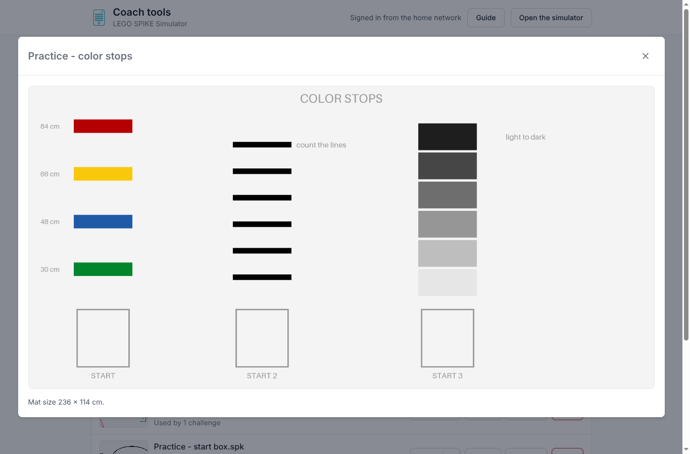

# What this fork adds

This repository is a modified version of the
[LEGO SPIKE Simulator by Alexandre Hardy](https://github.com/alexandrehardy/lego-spike-simulator).
The original simulator runs SPIKE word-block programs (`.llsp3`) against an
LDraw robot model on a scene with a mat image and obstacles, all in the
browser. Everything in that core (the Blockly editor, the block VM, the 3D view,
LDraw loading, ports and wheels, scenes) is Alexandre Hardy's work, and this
fork builds on it.

This page lists what the fork adds, grouped by who uses it. The fork starts
after commit `94b2cf8` ("Update basic readme", March 2026); everything after
that is in `git log 94b2cf8..`. Like the original, the fork is distributed under
the GNU General Public License version 2 ([COPYING.md](../COPYING.md)).

In short, the original is a simulator; the fork turns it into a small team site
for a robotics club: a hosted simulator with a shared library, lessons and
challenges that check themselves, student sign-in with saved progress,
assignments, and a coach page to run it all.

## Contents

-   [For students](#for-students)
-   [For coaches](#for-coaches)
-   [AI assistants for coaches](#ai-assistants-for-coaches)
-   [Simulator accuracy](#simulator-accuracy)
-   [The 3D view](#the-3d-view)
-   [Hosting and the server](#hosting-and-the-server)
-   [Privacy and safety](#privacy-and-safety)
-   [Content that ships with the fork](#content-that-ships-with-the-fork)
-   [Developer tools](#developer-tools)
-   [Where the code lives](#where-the-code-lives)
-   [Known limitations](#known-limitations)

## For students

### Getting started

-   **Devices.** The site works on laptops, Chromebooks and full-size tablets.
    Phones and small tablets are not supported, because their screens are too
    small for block coding.
-   **Welcome screen** on the first visit, with what the simulator is and how to
    begin.
-   **Guide** (the ? button): how to use the simulator, a searchable block
    reference, and an About tab crediting the original author and listing the
    licenses.
-   **Simpler toolbar.** Robot and Field pick from the shared library, with mat
    pictures. Building tools (open a robot file, ports, wheels, scene editor,
    save) sit behind a Build toggle, which is on by default for coaches. Every
    toolbar button has a text label.
-   **Autosave.** The code panel saves the program in the browser and restores
    it on the next visit.
-   **In-app dialogs** replace the browser's `alert()` and `confirm()` popups.

### Learning the blocks

-   **Block help.** Hovering a block shows a plain-English tooltip, and
    right-click "Explain this block" opens a card with a preview, an example,
    common mistakes and notes on how the simulator treats it.
-   **Example programs** (Examples button): eight programs from "Drive a square"
    to "Mission template", each with an explanation of what it does, why it
    works and things to try.
-   **Team missions** (Missions button, signed-in students only): the team's
    own programs for the season's missions, with what the robot has to do, a
    video, the mission field and FIRST's guided mission. Students open any saved
    version, improve it in the simulator and save a new version with a note;
    nothing is overwritten. See [missions.md](missions.md).

### Lessons

-   **Lessons** (Lessons button): step-by-step activities with a Set up button
    that loads the starter program, robot and field, steps to tick off, and an
    optional check.
-   **Lesson complete.** A lesson is done when every step is ticked, its check
    has passed and, for a signed-in student, a program has been handed in.
    Students then see a "Lesson complete" banner with a Next lesson button and
    cards for related challenges. Until then a "To finish this lesson" list
    shows what is left.

### Challenges

-   **Challenges** (Challenges button): short goals such as "stop on green 5 out
    of 5 times on Challenging", with a field, a realism level, hints revealed one
    at a time, and links to related examples. Each challenge lists the lessons
    it is practiced in, and the best score is kept.

### Checking and experimenting

-   **Check button.** While a lesson check or challenge is open, a green Check
    button runs the program five times and reports each run as a pass or a
    fail. Run on its own is always a single try.
-   **Checks** can ask for a stop zone (with a heading), waypoints in order,
    stay-out zones, following a line (the color sensor stays inside a corridor
    along a traced path), a time limit and block rules.
-   **Experiment panel.** Runs a program five times and draws every path on the
    mat with how far apart the runs ended, then "Keep as A" and run Program B to
    see which one is more consistent.
-   **Realism levels.** "Ideal" is the perfect robot of the original simulator.
    "Realistic" and "Challenging" add start position errors, wheel size
    mismatch, wheel slip, motor overshoot, gyro drift and sensor noise, so
    programs that only count rotations drift and programs that check sensors
    stay on target. The Mode button in the simulator toolbar picks a level and
    shows what to expect in each, and a link such as `/?realism=realistic`
    picks a level.

### Tools on the mat

-   **Sensor graph** (chart button): live rows for yaw, light, distance, force
    and motor degrees during a run; afterward it shows the whole run and
    hovering reads the values at any moment.
-   **Measure tool** (ruler button): click waypoints on the mat to get drive
    distances and turns from the robot's start, with a 10 cm grid, inches, undo
    and copy.
-   **Place view** (map pin button): a top-down view to drag the robot and
    obstacles, turn them with a handle or the scroll wheel, or type exact
    positions.
-   **Camera control.** During a run, drag the 3D view to orbit, right-drag,
    Shift-drag or drag with two fingers to pan, and scroll or pinch to zoom.
    Double-click or Reset view goes back to the chosen view. A Camera button in the corner of the view lists these controls. The list
    opens by itself at the start of each run and closes when the student moves
    the view, and the guide's Camera entry explains it too.

### Signing in and assignments

-   **Sign in with a code.** Each student gets a code such as `WORD-WORD-NN` (no
    email or sign-up) and signs in with the Sign in button or a `/#code=...`
    link from their coach. Students who are not signed in are
    reminded once per visit when they start real work, and signing in asks
    whether the work already on that computer is theirs before adding it.
-   **Saved progress.** For signed-in students, ticked steps, check results and
    challenge results are saved on the server, so they follow the student to
    any computer.
-   **Assignments** appear at the top of the Lessons window with a due date and
    a "Practice" or "Prep for next meeting" badge.
-   **Hand in** saves the current program for the coach to see. An assignment
    can require a lesson's check to pass first.
-   **Student card.** The toolbar button shows the student's initial and opens a
    card with their name, whether their work is saved, lessons and challenges
    finished, the next assignment due, and Sign out. Signing out waits for any
    upload still running, clears the code panel for the next person, and can
    happen automatically after a set time on shared computers.

## For coaches

Coaches have their own page at `/coach`, behind the coach sign-in (see
[Hosting](#hosting-and-the-server)). A Guide button opens a getting-started
checklist and a section per tab; it opens by itself the first time a coach
signs in on a browser. The tabs are:

-   **Lessons.** Write lessons with the New lesson form and a live student
    preview, draw the check on the mat (zones, waypoints, line corridors),
    link related challenges, and import or export lessons as zip packages. New
    and imported lessons are drafts until a coach presses Publish.
-   **Challenges.** Make, edit, publish, import and delete challenges with the
    same mat editor. Drafts are hidden from students.
-   **Programs.** The public catalog of programs that lessons and challenges
    load. Upload, rename, download and delete them; Add to Examples (with an
    explanation) shows one in students' Examples window, and Hide from Examples
    takes it out again without deleting it.
-   **Missions.** The team's missions and every version of their programs, kept
    out of the public library. Add versions from SPIKE app files with the day
    they were saved, mark the version to use at the competition, and download any version.
-   **Assignments.** Pick lessons, an optional due date and a type (practice or
    prep for the next meeting), and optionally require the check to pass before
    hand-in. A grid shows every student's status on every lesson, with a link to
    download each handed-in program.
-   **Students.** Paste a list of names to give each student a random code,
    print cut-out code cards, copy one student's link,
    export a CSV for a mail merge, issue new codes for everyone, and download a
    backup of the team and library. The page asks before adding names that look
    like full surnames.
-   **Robots and maps.** Upload, rename, download and delete robots and fields,
    choose the robot and field that load when the simulator opens, click a
    field to see its mat full size, and view a robot in 3D with its size.
    Coaches can also save a start position from the Place view into a field.
-   **Team settings.** Team name, a note for families that can be copied,
    automatic sign-out on shared computers, what AI assistants may see about
    students, and Remove all students. The `HEAD_COACHES` setting can limit
    these to named coaches.
-   **AI assistants.** How to connect an assistant to the site (below), and the
    package-and-import route for chatbots that cannot connect.

## AI assistants for coaches

Coaches can connect Claude, or any assistant that speaks MCP, to `/mcp` and ask
it to write lessons and challenges, set assignments, read team progress, and
add robots, fields, example programs and the team's mission programs,
including drawing a new practice mat from a short description. Each coach signs in as themselves, everything the assistant saves
is a draft stamped with that coach's email, and nothing reaches students until a
coach publishes it. By default an assistant sees only per-lesson statistics, not
students' names. Setup and the tool list are in [mcp.md](mcp.md), the lesson and
challenge format in [lessons.md](lessons.md), and the field format in
[fields.md](fields.md). An assistant sends a program or model file through a one-time
upload link instead of pasting it into the conversation, and gets back a
checksum to confirm the file arrived unchanged.

For assistants without MCP, the same material is available read-only over HTTP:
`GET /api/lessons/guide`, `GET /api/lessons/schema` and
`POST /api/lessons/check`.

## Simulator accuracy

The fork ran the block VM headless in every realism level, compared the paths
with hand-worked geometry, and fixed what did not match:

-   Arcs (both wheels forward at different speeds) turned about the wrong
    point, so curves ended too far out.
-   Wheels whose speeds differed slightly drove dead straight, and nearly equal
    speeds could make the robot jump sideways.
-   "Run motor for N degrees" ran N rotations.
-   Timed moves lost their last step, and stop overshoot on reversed motors
    turned the robot left.
-   Wheel slip averaged out instead of making runs really differ.
-   The timer used the wall clock and counted the start delay.
-   A negative motor speed stopped motor turn and go-to blocks working, and
    steer for a distance did not move.
-   The start delay setting was in the wrong units, and the color sensor could
    report more than 100% reflected light.
-   Light sensor noise used the wrong scale.

-   The color, distance and force sensors updated once per screen frame, so a
    program behaved differently on a slow Chromebook than on a fast desktop,
    and worse at higher time scales. They are now read every 10 ms of
    simulated time.
-   The distance sensor read in steps of about 8 mm; it now reads in 1 mm
    steps.
-   Sensor views were antialiased, so the color sensor saw blended colors at
    edges that aren't on the mat.

As in the original, the robot does not move until the program sets a movement
speed. `npm run physics` repeats these checks (see
[tools/physics/README.md](../tools/physics/README.md)).

## The 3D view

-   Bricks are shaded by the angle of each face, so robots read as 3D. Sensor
    views stay unshaded so the sensors see the real colors.
-   Mats are mipmapped, so thin lines and text don't shimmer when zoomed out.
-   The view is drawn at no more than 1.5 times the screen's pixel density, and
    sensor views at 1x. With the sensor changes above, this took a tablet in
    Chrome from about 33 to 60 or more frames per second.
-   Settings has "Show frame rate (FPS)", which shows the frame rate, the draw
    time and the canvas size in the corner of the 3D view.

## Hosting and the server

The original builds to static files that run straight from disk. The fork adds
a small Node server (`server/server.mjs`, no dependencies beyond Node) and a
Docker image, `ghcr.io/danmartinez78/lego-spike-simulator`, built by GitHub
Actions: `:latest` on every push to `master`, `:test` for the `test` branch
that the test container runs, and `:branch-<name>` for `claude/**` and
`feature/**` branches, so a branch can be tried in a test container first (see
the
[README](../README.md#try-a-branch-in-a-test-container)). The server:

-   serves the simulator, the coach page and the privacy notice;
-   downloads the LDraw parts library once and serves it, so robots and fields
    load their bricks without anyone uploading `complete.zip`;
-   keeps the shared library of robots, fields, example programs, lessons and
    challenges in `/data/library`, seeding the bundled presets once;
-   keeps the team (roster, settings, progress, handed-in programs) in
    `/data/team`;
-   accepts coach changes only from the home network (`LAN_WRITE_PREFIXES`) or
    from people signed in through Cloudflare Access (`CF_ACCESS_TEAM_DOMAIN`
    and `CF_ACCESS_AUD`).

The settings are listed in the [README](../README.md#run-your-own-copy).

## Privacy and safety

-   Students sign in with a code, never an email address. Codes are limited to
    10 wrong tries per address every 10 minutes.
-   A privacy notice for families at `/privacy`, linked from the welcome screen
    and the guide.
-   Coach changes are refused when they come from another website, drafts are
    left out of the public library, and server logs name students by id rather
    than by name.
-   Team settings control what AI assistants see and when shared computers sign
    out.
-   Download backup saves the whole team and library as one zip.
-   Team mission programs are only served to coaches and signed-in students,
    never through the public library.

## Content that ships with the fork

All of this is in `presets/` and is copied into the library on first start.

-   **Robots:** Driving Base 3, and Driving Base 3 with a distance sensor on
    port F.
-   **Fields:** start box, line oval, line course, color stops, accuracy
    targets, turn rose, wall course and mini missions.
-   **Example programs:** eight, from "Drive a square" to "Mission template",
    each with an explanation.
-   **Challenges:** eight, covering driving, sensors, the gyro and missions,
    each tested against a reference solution.
-   **Lessons:** one sample lesson to copy when writing new ones.

The examples, fields and challenge solutions are generated by the scripts in
`tools/examples/`, and the distance sensor robot by `tools/robots/make_db3d.py`.

## Developer tools

-   `npm run physics`: headless checks of the VM against worked geometry, the
    realism spread and the color sensor examples.
-   `tools/examples/`: generators for the example programs, practice fields,
    scenes and challenge solutions.
-   `schemas/`: JSON schemas for lessons and challenges; the validation rules in
    `server/lesson-rules.mjs` are shared by the server and the app.

## Where the code lives

| Area                        | Files                                                                          |
| --------------------------- | ------------------------------------------------------------------------------ |
| Server and library API      | `server/server.mjs`                                                            |
| Lessons, challenges, checks | `server/lessons-api.mjs`, `server/lesson-rules.mjs`, `src/lib/spike/checks.ts` |
| Students and assignments    | `server/team.mjs`, `server/homework.mjs`, `src/lib/homework.ts`                |
| Team missions               | `server/missions.mjs`, `src/lib/missions.ts`, `MissionsDialog.svelte`          |
| Team settings               | `server/settings.mjs`, `src/lib/settings.ts`                                   |
| AI assistants (MCP)         | `server/mcp.mjs`, `server/fields.mjs`, `server/uploads.mjs`                    |
| Realism and runs            | `src/lib/spike/realism.ts`, `src/lib/spike/runs.ts`                            |
| 3D view and sensor views    | `src/lib/ldraw/gl.ts`, `src/lib/ldraw/shaders.ts`, `src/components/*Sensor*`   |
| Coach page                  | `src/pages/CoachPage.svelte`, `src/components/coach/`                          |
| Privacy notice              | `src/pages/PrivacyPage.svelte`                                                 |
| Block help                  | `src/lib/blockly/blockhelp.ts`                                                 |

Assignments are called homework in the code, file names and API paths.
[HANDOFF.md](../HANDOFF.md) has more detail on how the pieces fit together.

## Known limitations

-   Robots drive through obstacles (there is no object physics), tilt and
    gesture sensors are not simulated, and acceleration and stop-method blocks
    are ignored.
-   There is no robot builder in the site; build in BrickLink Studio or LeoCAD
    and load the `.mpd` file.
-   Progress is kept per browser unless the student signs in.
